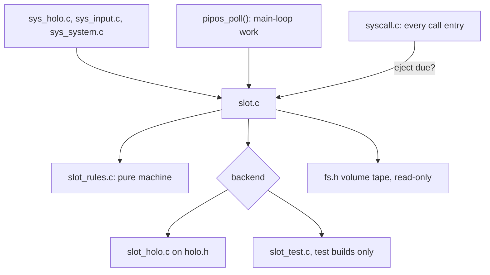
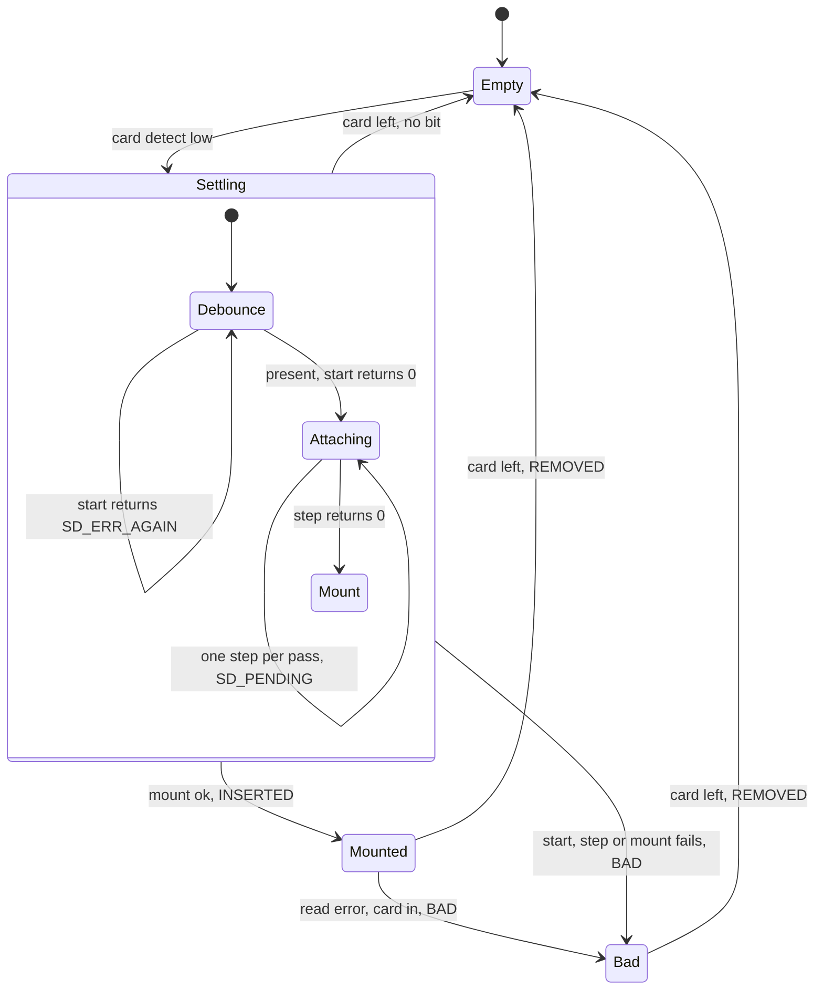

# Architecture

This page is for a developer who changes the kernel. It says where each part lives and how the parts fit. The call contract is in [API.md](API.md), the boot markers in [BOOT.md](BOOT.md), the build in [BUILD.md](BUILD.md) and the tests in [TESTING.md](TESTING.md).

## What Pip-OS is

Pip-OS is a bare-metal AArch32 kernel for the Raspberry Pi. It boots from the Pi firmware, shows a boot screen, loads one ROM from the SD card and runs it in USR mode behind MMU regions. The ROM reaches the kernel only through `svc` system calls. A ROM can launch a holotape, a second image that runs inside the ROM's system call. The kernel itself holds the policy: the boot screen, the slots, the sandbox regions and the system calls. RobCo-Core, the git submodule in `external/robco-core`, holds the drivers, the start-up code, the image format and the build rules.

| Concern | Where it lives |
|---|---|
| Start-up code, vectors, board detection, `robco_main()` call | RobCo-Core `src/arch`, `src/board` |
| MMU, caches, USR-mode tasks (`umode.h`) | RobCo-Core `src/arch` |
| UART, mini UART, GPIO, I2C, SD, framebuffer, PWM audio, RTC, timer | RobCo-Core `src/drv` |
| FAT file system, MBR scan, INI parser | RobCo-Core `src/fs`, `src/lib` |
| Screen console and fonts | RobCo-Core `src/gfx` |
| `rimg` image format and stage loader | RobCo-Core `src/lib`, `tools/rimg.py` |
| Build rules, host test rules | RobCo-Core `mk/robco.mk`, `mk/host.mk` |
| Boot order, boot screen, card and ROM checks | `kernel/main.c`, `kernel/card.c`, `kernel/bootlines.c`, `kernel/screen.c` |
| The disk click: the click debt and its limiter, the block device wrapper, the boot note and the clicks mixed over it | `kernel/dsound_rules.c`, `kernel/dsound.c` |
| Running an image | `kernel/rom.c`, `kernel/rom.h` |
| System-call dispatch | `kernel/syscall.c`, `kernel/sysdispatch.c`, `kernel/sys.h` |
| System-call groups | `kernel/sys_<group>.c` |
| Build-time settings and pins | `kernel/robco_config.h` |
| ABI header shared with ROM code | `sdk/include/pipos/abi.h` |
| ROM and holotape SDK | `sdk/` |

The library's own guide is in [RobCo-Core `docs/guide`](https://github.com/RobCo-Industries/RobCo-Core/blob/c0bee999b3c0993bd627ca5c4b0ecc8512563fca/docs/guide/API.md).

## Boot flow

The firmware loads `PIPOS.IMG` at `0x8000` and enters it. RobCo-Core's start-up code sets the stacks and vectors, detects the board and calls `robco_main()` in `kernel/main.c`.

1. `uart_init(115200)` and the `ev=boot` marker.
2. `start_display()`: `mmu_init()`, `mmu_enable()`, `fb_init(640, 480, 32)`, `console_init()` in green.
3. `start_heap()`: `k_heap_init()` on the region `robco_heap_slot()` returns.
4. `start_tick()`: `irq_init()`, `tick_init(PIPOS_TICK_HZ)` at 100 Hz, interrupts on.
5. `start_input()`: mini UART, the six GPIO buttons and the dial, the serial console, the script channel with `script_command()` as handler.
6. `start_audio()`: `audio_init()`, PWM or the trace backend.
7. `start_clock()`: `i2c_init()` and `rtc_init()`.
8. `pipos_card_mount()` in `card.c`: `sd_init()`, then `fs_mount_boot()`.
9. `pipos_config_load()` reads `/PIPBOY/PIPOS.CFG` through `pipos_settings_parse()`.
10. `apply_settings()`: scheme, volume, line delay, power-on beep. `pipos_dsound_start()` in `dsound.c` then starts the disk click when the system sound runs. Then `pipos_display_start()` in `display.c` starts the SPI panel when `[display] backend` asks for it.
11. `pipos_sys_init()` in `syscall.c`: builds the call index, runs every group's `init`, installs the `svc` handler.
12. `boot_screen()`: the head lines, `pipos_holo_count()`, `pipos_rom_load()`, the ROM line, the tail lines.
13. `pipos_rom_run()` in `rom.c` when the ROM passed the check.
14. `main_loop()`, after the `ev=ready` marker.

```
firmware -> robco_main -> uart, mmu, fb, heap, tick, input, audio, clock
         -> card, config, settings -> sys_init -> boot screen + ROM check
         -> ROM in USR mode (may launch a holotape) -> main loop
```

A failure in `mmu_init()`, `fb_init()`, `console_init()`, the heap or the tick calls `pipos_panic()` in `kernel/panic.c`. So does a bad call table in `pipos_sys_init()` and a back buffer the ROM could reach in `pipos_gfx_init()`. A card, configuration or ROM failure never stops the boot.

## Memory map

The kernel follows the Pip-Boy chain of RobCo-Core's [MEMORY_MAP.md](https://github.com/RobCo-Industries/RobCo-Core/blob/c0bee999b3c0993bd627ca5c4b0ecc8512563fca/docs/spec/MEMORY_MAP.md#pip-boy-chain). That page is the contract. This table is what the code uses.

| Range | Use | Defined in |
|---|---|---|
| `0x00008000`-`0x003FFFFF` | Kernel image, stacks, MMU table, kernel heap | `LINK_ADDR`, `SLOT_END` in `Makefile`, `ROBCO_SLOT_END` in `kernel/robco_config.h` |
| `0x00400000`-`0x007FFFFF` | ROM slot | `PIP_ROM_BASE`, `PIP_ROM_SIZE` in `sdk/include/pipos/abi.h` |
| `0x00800000`-`0x00BFFFFF` | Holotape slot | `PIPOS_HOLO_BASE`, `PIPOS_HOLO_SIZE` in `kernel/holo.h` |
| `0x00C00000`-`0x00C4AFFF` | Graphics back buffer, kernel only | `GFX_BB_BASE` in `kernel/display.h` |
| `0x00C80000`-`0x00CCAFFF` | The last frame sent to the panel, kernel only | `GFX_SHADOW_BASE` |
| `0x00D00000`-`0x00D4AFFF` | The panel console frame, kernel only | `GFX_CONSOLE_BASE` |
| `0x00D80000`-`0x00FFFFFF` | Test builds: the panel transcript | `GFX_TAP_BASE`, `GFX_TAP_END` |
| `0x01000000`-`0x017FFFFF` | ROM heap, 64 KiB ROM stack at the top | `PIP_ROM_HEAP_BASE`, `PIP_ROM_STACK_TOP` |
| `0x01800000`-`0x01FFFFFF` | Holotape heap, 64 KiB holotape stack at the top | `PIPOS_HOLO_HEAP_BASE`, `PIPOS_HOLO_STACK_TOP` |

```
0x00008000 | kernel                 | privileged
0x00400000 | ROM slot               | ROM rw, holotape ro
0x00800000 | holotape slot          | holotape rw
0x00C00000 | back buffer, panel     | privileged
0x01000000 | ROM heap + stack       | ROM rw
0x01800000 | holotape heap + stack  | holotape rw
0x02000000 | unused
```

The startup block of each image sits at the bottom of its stack, `stack_top - 0x10000`. The `umode` return stub sits 128 bytes above it. `PIPOS_ROM_STARTUP` and `PIPOS_ROM_STUB` are in `kernel/sysabi.h`, the holotape ones in `kernel/holo.h`. The framebuffer lives in GPU memory.

## How an image runs

`kernel/card.c` loads the ROM with RobCo-Core's `loader_load()` into the ROM slot. It expects the `ROM1` magic and ABI major 1. The loader runs the [IMAGE_FORMAT.md](https://github.com/RobCo-Industries/RobCo-Core/blob/c0bee999b3c0993bd627ca5c4b0ecc8512563fca/docs/spec/IMAGE_FORMAT.md#validation) checks: magic, header version, size, slot bounds, ABI and CRC. `pipos_rom_error_line()` in `bootlines.c` turns each `rimg` error into the screen text.

`pipos_image_run()` in `kernel/rom.c` runs both kinds of image:

1. It cleans the loaded bytes to memory.
2. It fills a `umode_task_t`: entry at the slot base, `sp` at the stack top, `r0` at the startup block, the stub, the regions.
3. It calls `pipos_sys_image_start(kind)`, prints the start marker and calls `umode_run()`.
4. After the image ends, it calls `pipos_sys_image_end(kind)`.

| Image | Regions | Start marker |
|---|---|---|
| ROM, `rom_regions` in `rom.c` | ROM slot rw, ROM heap rw | `ev=jump entry=0x00400000` |
| Holotape, `holo_regions` in `sys_holo.c` | ROM slot ro, holotape slot rw, holotape heap rw | `ev=holo_start name=<NAME>` |

`umode_run()` maps only these regions for USR mode while the image runs. Everything else, the ROM heap included while a holotape runs, stays privileged.

A holotape runs as an inner task, `umode` depth 2, inside the ROM's `holo_launch` call. `run_tape()` in `sys_holo.c` loads it with the `ROBCO78` magic into the holotape slot and writes its startup block with the argument string. The ROM waits in its system call until the holotape ends.

How an image ends:

| End | ROM | Holotape |
|---|---|---|
| `exit(n)` or return from the entry | `ev=rom_exit status=<n>` | `ev=holo_exit status=<n & 0xff>`, `holo_launch` returns it |
| Fault | `ev=rom_kill reason=<...> pc=...` and the line `ROM(1) <FAULT> AT 0x<pc>` on screen | `ev=holo_kill ...`, nothing on screen, `holo_launch` returns `-PIP_EFAULT` |
| `kill` script command | `ev=rom_kill reason=killed code=1` | `ev=holo_kill reason=killed`, `holo_launch` returns `-PIP_EFAULT` |
| `umode_run()` refused | `ev=error code=umode rc=<n>` | the same marker, `holo_launch` returns `-PIP_ENOEXEC` |

`pipos_image_report_kill()` in `rom.c` prints the kill markers. The fault names come from `pipos_fault_reason()` and `pipos_fault_line()` in `sysabi.c`. After the ROM ends, the kernel enters the main loop. It does not load the ROM again.

## System-call dispatch

A ROM puts the call number in `r7` and the arguments in `r0` to `r3`, then runs `svc`. RobCo-Core's `umode` code calls `on_svc()` in `kernel/syscall.c`. It builds a `pipos_sys_ctx_t` with the image kind, the register frame and the pointer checks, then calls `pipos_sys_dispatch()`. The result goes back in `r0`. An unknown number returns `-PIP_ENOSYS`.

Each group file defines one table with `PIPOS_SYS_ENTRY(GROUP, NAME, handler)` lines and `PIPOS_SYS_TABLE()`. `PIPOS_SYS_OWNER()` in `kernel/sys.h` maps each number to its group. An entry in the wrong group fails the build. At boot, `pipos_sys_index_build()` in `sysdispatch.c` builds a 128-entry index from the seven tables. A number listed twice or outside the ABI stops the boot with a panic. `ev=syscalls served=<hex>` lists the numbers with a handler.

| Group | File | Numbers |
|---|---|---|
| system | `sys_system.c` | `0x42`-`0x46`, `0x48`, `0x49` |
| gfx | `sys_gfx.c` | `0x01`-`0x0F` |
| input | `sys_input.c` | `0x10`-`0x13` |
| audio | `sys_audio.c` | `0x20`-`0x25` |
| time | `sys_time.c` | `0x30`, `0x31`, `0x40`, `0x41`, `0x47`, `0x4A` |
| storage | `sys_storage.c` | `0x50`-`0x57` |
| holo | `sys_holo.c` | `0x60`-`0x63` |

Each group exports four hooks, declared by `PIPOS_SYS_GROUP()` in `sys.h`:

| Hook | When |
|---|---|
| `init` | Once at boot, after the card and the settings, before the ROM |
| `image_start(kind)` | Before a ROM or holotape runs: reset per-image state |
| `image_end(kind)` | After it ended by exit, return, fault or kill: release its resources. Runs in reverse group order. |
| `poll` | From `pipos_poll()` and from the main loop |

Handlers never touch a user pointer directly. They use the helpers in `sysdispatch.c`: `pipos_user_check_in()`, `pipos_user_check_out()`, `pipos_user_copy_in()`, `pipos_user_copy_out()`, `pipos_user_strlen()` and `pipos_user_str()`. Each asks `umode_range_ok()` or `umode_strnlen_ok()` about the running image's regions and returns `-PIP_EFAULT` for a bad range. `pipos_sys_rom_only()` returns `-PIP_EPERM` to a holotape.

The kernel has one thread. While an image runs, the main loop does not. A blocking call such as `sleep_ms` or `wait_event` loops on `pipos_poll()` and `wfi` until its deadline. `pipos_poll()` in `main.c` runs `audio_poll()`, takes input events and runs every group's `poll`. That keeps script commands, input and audio alive during the wait. `read_buttons`, `read_dial` and `holo_enumerate` call `pipos_poll()` too.

## The groups

### system

`sys_system.c`: `ticks_ms`, `sleep_ms`, `exit`, `sys_info`, `mem_info`, `log`, `rand`. No per-image state. `mem_info` gives a holotape its own heap and stack. `log` writes to the PL011 and turns bytes that are not printable into `?`. `rand` uses RobCo-Core's `rng.h`, `sleep_ms` the 1 MHz `timer.h`. Pure parts in `sysabi.c`, tested by `tests/host/test_sysabi.c`.

### gfx

`sys_gfx.c`: 15 drawing calls on a 320 by 240 back buffer at `0x00C00000`. `present` scales it by the largest whole factor, 2 at 640 by 480, into the framebuffer from RobCo-Core's `fb.h`. Text uses the RobCo-Core font. State: colour, clip, font and who owns the screen. A holotape starts with fresh state and the ROM gets its state back afterwards. When a ROM ends on a lit display, the boot console comes back. After a scroll, `rom.c` has the kernel write the boot text back before the image end hooks run, so this redraw is the one frame with the text. `pipos_gfx_blank()` serves `power`. Pure code in `gfx_draw.c`, tested by `tests/host/test_gfx.c` and by golden PNGs in `tests/golden/`.

### Display path

`kernel/display.c` drives the backends. `[display] backend` picks them, see [CONFIG.md](CONFIG.md#spi-panel).

- HDMI: `present` scales the back buffer by 2 into the framebuffer, as before.
- Panel: `present` compares the back buffer with the shadow, a copy of the last frame sent at `0x00C80000`. `gfx_dirty_rect()` in `gfx_draw.c` finds the smallest rectangle that holds every changed pixel the panel shows. At 0 and 180 degrees the panel shows the left 240 columns and the top 240 rows, so it looks only there, with the 320-pixel row stride. A change outside that window is never sent and never reaches the shadow. It skips equal rows from the top and the bottom, then looks for the leftmost and rightmost change in the rows between. RobCo-Core's `tft_present_px32_rect()` sends that rectangle in RGB565, and `gfx_copy_rect()` copies it into the shadow. An unchanged frame sends nothing.
- The whole frame goes out after `tft_init()`, after `power` wakes the screen, after the boot text comes back on a screen a ROM left blanked, after a holotape returns and after a failed send.
- A panic after `power` blanked the screen wakes the panel first: sleep out, display on, backlight on. Then the whole console frame goes out. `tft_sleep()` returns at once when the timer has stopped, and every SPI wait fails after 20 ms plus four byte times with no byte moved, so the panic path stays bounded. A failed panel call skips the rest of the wake; the frame is still sent. On HDMI the panic text lands on the black screen, since the console draws straight into the framebuffer.

Cost on the wire: a rectangle of w by h pixels takes 11 bytes of window commands and `2 * w * h` bytes of pixels. At 9.62 MHz, the rate set for the default 10 MHz:

| Change | Bytes | Time |
|---|---|---|
| Whole frame, 320x240 | 153611 | 128 ms |
| One line of text, 320x16 | 10251 | 8.5 ms |
| A 16x16 icon | 523 | 0.43 ms |
| One pixel | 13 | 11 us |

`present` sends in the system call. It is bounded by the whole frame: 128 ms at the default rate, 1.23 s at the 1 MHz minimum. The SPI driver polls with interrupts on. The tick, input sampling and PCM, one timer interrupt per sample, keep running. Trace lines and script commands wait for the next `pipos_poll()`. So a ROM that streams sound only needs chunks longer than one `present`. A 64000-byte chunk lasts 8 s. `test_stream_while_redrawing` in `tests/test_tft.py` redraws the whole screen in every frame while it streams 3 such chunks, and checks the trace has no gap. Sending in strips over several ticks would bound the call lower but adds state, so the kernel does not.

The panel console: with the panel in use, boot text and panic text also reach the panel. `display.c` keeps the last 15 lines, cut at 40 characters, and draws them with the 8x16 font into the console frame at `0x00D00000`. It sends that frame the same way, against the shadow. Lines before `pipos_display_start()` and a panic before it never reach the panel. With `backend = tft` HDMI keeps the boot console and shows no frame.

A panel call that fails after boot is counted. The first prints `ev=display_error`. A failed send may leave part of a rectangle on the panel, so the kernel tries once more with the whole frame. If that fails too, `present` returns `-PIP_EIO`, the kernel keeps running and sends the whole frame next time. RobCo-Core's SPI driver fails a send only when no byte moves for 20 ms plus four byte times, and it reads the controller once more before it gives up. A slow but moving send never fails, whatever its length. So a retry needs a bus that stops, on hardware or in QEMU. A send that stops costs one such window, and its retry at most one more, on top of the bytes that went out. The panel tests still accept one retry per present, see [TESTING.md](TESTING.md#host-timing).

### input

`sys_input.c`: `read_buttons`, `read_dial`, `poll_event`, `wait_event`. `main.c` hands every RobCo-Core input event to `pipos_input_event()`. The group keeps a 32-event queue and drops the oldest event when full. Events reach the queue only while an image runs. `image_start` and `image_end` empty the queue, so a holotape and the ROM never see each other's events. `read_buttons` reads RobCo-Core's held-key state and `read_dial` its dial total, 15 degrees per detent. Pure code in `input_events.c`, tested by `tests/host/test_input_events.c`.

### audio

`sys_audio.c`: `tone`, `sample`, `audio_stop`, `volume`, `audio_status`, `play_seq`, `sample_queue`, `sample_rate`. One voice through RobCo-Core's `audio.h`, PWM on hardware and a trace backend in QEMU. A new sound replaces the one that plays. `sample` copies up to 64 KiB of PCM into a static buffer, at 8000 or 37500 Hz. `play_seq` takes up to 256 notes. `image_start` and `image_end` stop a sound the image started. The sample rate is per-image state, like the drawing state: `image_start` saves the ROM's rate when a holotape starts and sets 8000 Hz for every image, and a holotape's `image_end` gives the ROM its rate back. A new play passes the rate in force to the driver. A queued buffer passes none: the driver plays it at the rate of its play. Pure rules in `audio_rules.c`, tested by `tests/host/test_audio.c`.

### time

`sys_time.c`: `read_sensor`, `sensor_available`, `get_time`, `get_battery`, `power`, `set_time`. A software clock in Unix seconds on the 1 MHz timer. `init` seeds it from the RTC when `rtc_init()` found a chip with a valid time. `set_time` sets only the software clock. Sensor 0 is the clock, sensors 1 to 6 report nothing. `get_battery` returns `-PIP_ENODEV`. `power` reboots, halts, blanks or lights the screen. A holotape gets `-PIP_EPERM` from `set_time` and `power`. Pure code in `time_clock.c`, tested by `tests/host/test_time.c`.

### storage

`sys_storage.c`: saves and read-only files, `0x50`-`0x57`, through RobCo-Core's `fs.h`. Saves are `/PIPBOY/SAVE/<NAME>.SAV`, at most 64 KiB, written whole through work files marked `~` and `#`. File calls cannot reach the save folder by any name or 8.3 alias. State: one table of 8 handles per image level, so the ROM's files stay open and out of reach while a holotape runs. `image_start` and `image_end` close the level's handles. Pure rules in `storage_rules.c`, tested by `tests/host/test_storage.c`.

RobCo-Core mounts up to `ROBCO_FS_VOLUMES` volumes at once, 2 by default, and Pip-OS keeps the default. The boot card uses the first slot. The second slot holds the holotape card. Each slot costs 592 bytes of BSS in `fs_vols`, so the second slot costs 592 bytes of kernel RAM, mostly the FatFs sector window.

### holo

`sys_holo.c`: `holo_enumerate`, `holo_launch`, `holo_last_status`, `holo_eject_event`. Lists up to 32 `.HTP` files from the slot card's root folder, then `/PIPBOY/HOLO`. See [Holotape slot](#holotape-slot). The listing is a first header check: it checks magic, header version and file size. `holo_launch` loads and runs one tape as described above, after the full validation. So it can refuse a listed tape for its slot bounds, ABI major or CRC. Only the ROM may launch. State: the last launch result and a running flag. `holo_eject_event` returns the slot module's pending bits to the ROM. Pure rules in `holo_rules.c` and `slot_rules.c`, tested by `tests/host/test_holo.c` and `tests/host/test_slot.c`.

### Holotape slot

One module owns the slot of ABI 1.4: its state, the bits pending for the ROM, the mount and the eject.

| File | Role |
|---|---|
| `slot_rules.c`, `slot.h` | Pure. The state machine of the spec's diagram and the listing rule. Inputs: card detect, the attach start and step results, the mount result, a failed read on the tape volume. Outputs: the action to take and the `PIP_HOLO_EV_*` bits. |
| `slot.c` | Runs the machine on a backend. Mounts the card as volume `tape` with `FS_MOUNT_RDONLY`, ejects it with `fs_eject()`, queues `PIP_EV_TAPE`. |
| `slot_backend.h` | The backend interface: `init`, `card`, `present`, `attach_start`, `attach_step`, `detach`, `blkdev` |
| `slot_holo.c` | The real backend on RobCo-Core's `holo.h`, `HOLO_CONFIG_DEFAULT` pins |
| `slot_test.c` | A RAM card for QEMU. Built only with `-DPIPOS_HOLO_TEST`. See [TESTING.md](TESTING.md#holotape-slot). |



`[holotape] slot = off`, the default, leaves the backend pointer NULL. Then no slot pin is touched, `PIP_HW_TAPE` is clear and every call behaves as ABI 1.3.

Slot work runs in `pipos_holo_poll()`, so in every pass of `pipos_poll()` and of the main loop. The calls the spec lists all do that work: `sleep_ms`, `poll_event`, `wait_event`, `read_buttons`, `read_dial`, `file_read`, `holo_enumerate` and `holo_eject_event`. `file_read` and `holo_eject_event` gained a `pipos_poll()` for it.

When the card of a running slot tape leaves, `on_svc()` in `syscall.c` sees it at the tape's next call of any kind. It reads the backend's card detect there, so a tape that never calls a work call is still caught. It calls `umode_request_kill()` and skips the call. The tape ends through the same path as a fault or the `kill` command, and `sys_holo.c` prints `ev=holo_kill reason=eject` and returns `-PIP_ENODEV`. A tape from the boot card is never marked.

#### The stepped attach

A card attaches in steps, with RobCo-Core's `holo_attach_start()` and `holo_attach_step()`. The machine starts the attach once the debounce is over. Then each work pass takes one step, until the step returns `0` or an error. A step never waits: during the card's power wait or a retry pause it returns `SD_PENDING` at once. Otherwise it clocks one protocol step, 64 bytes at most at 400 kHz, about 1.3 ms of wire time. That is the most one step holds the loop. Between two steps the bus is off and SPI0 is free for the panel. The mount runs in the pass of the last step and reads a few blocks.



Debounce, Attaching and Mount are inside the ABI's `Settling`. The ROM sees none of them apart. While an attach runs:

- The slot is `Settling`. `holo_enumerate` lists no slot tape and `holo_launch` looks on the boot card only, as with an empty slot. The `tape` volume is not mounted, so no call can reach a half-ready card.
- `holo_eject_event` returns no bit for the card and no `PIP_EV_TAPE` comes. `INSERTED` comes after the mount, as before. Only later.
- A pull ends the attach: `holo_poll()` or the detach stops it and no bit is set. A second card then starts its own debounce.
- A step that fails, `SD_ERR_SLOW` included, makes the card `Bad` with `PIP_HOLO_EV_BAD`. Pip-OS does not try it again until it leaves.

A new attach needs the slot `Empty` first. If a slot tape runs, its card was then seen to leave, so the tape is already marked to end at its next call. The 250 ms debounce of the next card comes after that.

How fast the steps come depends on the ROM. A ROM in `wait_event` or `sleep_ms` gets a work pass each 10 ms tick, so about a dozen passes for a card that leaves idle at its fourth ACMD41. A ROM that makes no work call stalls the attach, as it stalls every other slot change. The library's waits keep their time budget, so a card does not fail sooner when steps come slowly.

#### A slow card

A slow card now costs time, not the loop. The test backend fakes one: `holo delay 1200` makes the attach step for 1200 ms before its result, and each step returns at once. Nothing here ran on a real card. The `holo_attach` marker reports, for each attach:

- `ms`: from the start to the result.
- `polls`: the `pipos_poll()` passes in that time, after the start's own pass.
- `steps`: the step calls. One step per pass, so `steps` equals `polls`.
- `pcm0` and `pcm1`: `audio_busy()` at its start and its end, 1 while a sound plays.
- `pos0` and `pos1`: the samples the current PCM play has output at its start and its end, from `audio_pcm_samples()`.

Each pair is read with IRQs masked, so the PCM interrupt cannot run between the two reads.

`test_slow_attach_keeps_main_loop` plays a 7.5 s sample and inserts the slow card. It checks that `polls` equals `steps` and both are 2 or more, that a script command is served while the attach runs, and that the sample plays at both ends with the interrupt output samples in between. `test_slow_attach_keeps_a_stream_live` streams 100 ms chunks through `sample_queue`, at most 200 ms ahead. The stream lives through the 1200 ms attach only because the ROM keeps queueing during it. The test checks that a play runs at both ends of the attach, that the trace has no `pcm_end` in it and a chunk switch every 100 ms through it.

`pos1 - pos0` does not measure the sound's pace. It counts the samples the PCM interrupt output, one per interrupt QEMU delivered. A late interrupt skips to the sample its clock says is due, so the sound keeps its pace with fewer interrupts. How many interrupts arrive depends on the host. The test asserts only that it is above 0 and at most what 8 kHz makes due in `ms`.

One limit is new. A card whose CSD or CID data token comes later than the library's step budget ends as a bad card. The budget is `SDSPI_STEP_TOKEN_BYTES` in `sdspi.h`: 29 bytes, token included, about 0.58 ms at 400 kHz, for each of `SDSPI_TOKEN_TRIES`, 4, sends of CMD9 or CMD10. Then the step returns `SD_ERR_SLOW`. The blocking attach of the first ABI 1.4 kernel waited up to 100 ms for that token. No real card has been tried, so nobody knows yet whether such cards exist. The cure belongs in RobCo-Core: a stepped wait for the token by time, up to 100 ms.

Before RobCo-Core `cab5f69`, `holo_attach()` blocked for the whole attach, up to about 1.2 s: no work pass ran, a stream ran dry and the display froze. That limit is gone.

#### SPI0 and the panel

The ILI9341 panel and the slot card share SPI0. RobCo-Core's slot driver enables the card's bus only around its own transfers and needs the panel idle then. The two never overlap:

- Panel transfers start only in main context: `present` and `power` from a system call, boot text and the panic text from `pipos_screen_line()` and `pipos_panic()`, the script command `panic` from `pipos_poll()`. Pip-OS installs no interrupt handler that touches the display. The tick and the PCM interrupt belong to RobCo-Core and never use SPI0.
- Card reads happen only in main context too: each attach step and the mount in `pipos_slot_work()`, and the file system reads of `holo_enumerate` and `holo_launch`.
- Main context runs one thing at a time, and no panel or card function calls `pipos_poll()` in the middle of a transfer. `holo_enumerate` calls `pipos_poll()` only between two files, after each read finished.

So a panel transfer can never start during a card read, and the reverse. The same proof sits in the header comment of `kernel/slot.c`.

## Main loop and maintenance port

`main_loop()` in `main.c` runs `audio_poll()` and the group polls, then waits up to 20 ms for an input event. It prints one `ev=key` marker per event.

The mini UART carries RobCo-Core's script channel. `script_command()` in `main.c` adds five commands, and `tftdump` and `holo` in test builds:

| Command | Effect |
|---|---|
| `dump` | The screen console as text |
| `state` | `ready rom heap_free files holo` |
| `rtc` | The time the RTC chip holds |
| `kill` | Ends the innermost running image with `umode_request_kill()` |
| `panic <reason>` | Takes the panic path |

Every marker starts with `@RC stage=pipos` and follows [BOOT_PROTOCOL.md](https://github.com/RobCo-Industries/RobCo-Core/blob/c0bee999b3c0993bd627ca5c4b0ecc8512563fca/docs/spec/BOOT_PROTOCOL.md#serial-markers). The full marker list is in [BOOT.md](BOOT.md#markers). Markers go to the PL011 only. Boot text goes to the screen and the PL011, through `pipos_screen_line()` in `screen.c`.

## Build

`make` builds one `build/pipos.img` for every board. RobCo-Core's `mk/robco.mk` compiles with `-mcpu=arm1176jzf-s -marm -mfloat-abi=soft -mgeneral-regs-only -mno-unaligned-access`. The ARM1176 of the Pi Zero and Pi 1 is ARMv6, which has no `movw` and `movt`. Code built for it also runs on the Cortex-A7 and A53 of the Pi 2 and Pi 3 in 32-bit mode. Soft float with general registers only means no code uses FPU registers. `kernel/robco_config.h` is forced into every file, the assembler and the linker script included. The link fails when the image passes `0x00400000`.

`PURE_SRCS` in the `Makefile` lists the kernel files with no hardware access. Every `kernel/*.c` builds into the kernel. The host tests link only `PURE_SRCS`.

ROMs and holotapes build through `sdk/pipos-app.mk` with the same CPU flags. `KIND=rom` links with `sdk/rom.ld`, `KIND=holotape` with `sdk/holotape.ld`. Both start in `sdk/crt0.S` and link `libpip.a` from `sdk/lib/`. `tools/rimg.py` seals the result. [ROM_DEVELOPMENT.md](ROM_DEVELOPMENT.md) covers the SDK.

## Tests

| Layer | Where | Run by |
|---|---|---|
| Host unit tests of `PURE_SRCS` | `tests/host/test_<name>.c` | `make test-host` |
| `libpip.a` on the host | `tests/host/libpip_test.c` | `make test-host` |
| Shell tests of the build, SDK and card | `tests/host/*.sh` | `make test-host` |
| Target tests in QEMU on `raspi0`, `raspi1ap`, `raspi2b`, `raspi3b` | `tests/test_*.py` | `make test-target` |
| Golden screens | `tests/golden/*.png` | the target tests |
| Every system call against the spec, in QEMU or on a Pi | the [conformance ROM](TESTING.md#conformance-rom) in `conformance/` | `tests/test_conformance.py` |

Test ROMs are C files in `tests/roms/`, each linked with `rt.c`, the small runtime that prints `@RC stage=testrom` lines through `log`. Test holotapes are in `tests/roms/holo_tapes/`. `make test-roms` finds both by wildcard.

To test a new call:

1. Put its argument rules in a `PURE_SRCS` file and test them in `tests/host/test_<group>.c`.
2. Add its number and structs to `sdk/include/pipos/abi.h` and check them in `tests/host/test_abi.c`. Add its wrapper to `sdk/lib/syscall.c` and check it in `tests/host/test_sdk_calls.c`.
3. Write a test ROM in `tests/roms/` that calls it, and a test in `tests/test_<group>.py` that boots it.
4. `tests/test_syscalls.py` checks the served mask, so update what it expects.

## Known limits

- Pip-OS has run only in QEMU. Nothing is validated on a real board.
- QEMU 10.1 does not check execute permission for user code on the ARM1176 boards. A ROM that jumps into kernel memory runs kernel code in USR mode until a privileged instruction faults as `undef`.
- No CPU-time limit. A ROM that never makes a blocking call keeps the main loop from running, so no script command works, `kill` included. `test_scripts_stop_while_rom_spins` in `tests/test_rom.py` asserts this.
- A ROM runs once per boot. After it ends, the kernel stays in its main loop.
- One ROM file, `/PIPBOY/ROM1.ROM`. One holotape at a time, launched only by the ROM.
- The SPI panel is not validated on hardware. QEMU has no panel model, so the tests check the bytes sent, not a picture on glass.
- Sensors 1 to 6 and the battery report nothing. `holo_eject_event` always returns 0.
- `set_time` does not write the RTC chip, so the time set is lost at the next boot.
- Pi 4 is not supported.
