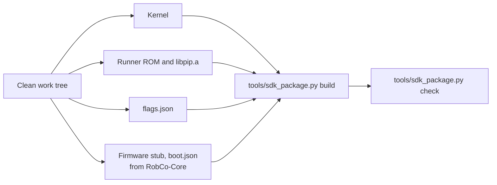

# The SDK package

`make sdk-package` writes `build/pipos-<version>.zip`, the `pipos` package that RobCo Studio installs. RobCo-Core's `docs/spec/SDK_PACKAGE.md` fixes its layout and its manifest, `sdk.json`. The version is the ABI of `sdk/include/pipos/abi.h` and `PACKAGE_BUILD`, so `1.4.0` today.

No package is published yet. A release needs the owner's agreement first.

## What the target does

1. It stops when a tracked file has changes, since `built_from` names the commits of Pip-OS and of `external/robco-core`.
2. It builds again, in `build/sdk-package/`, the kernel, the runner ROM with its `libpip.a`, `flags.json`, RobCo-Core's firmware stub and `boot.json`, with RobCo-Core's own `make boot-json`.
3. Every compile gets `-ffile-prefix-map` for the repository and the build folder, through `EXTRA_CFLAGS` for the kernel and `PATH_MAPS` of `pipos-app.mk` for the ROM and the library. The maps change the debug info only. The kernel image and the runner ROM are the same bytes as those of `make`.
4. `tools/sdk_package.py build` writes `sdk.json` and the archive. The firmware pins come from RobCo-Core's `tools/fetch_firmware.sh`. No firmware file goes in.
5. `tools/sdk_package.py check` checks the archive, then searches every file for the repository path, the build folder, `$HOME`, the user name and the host name.

## Same sources, same bytes

The archive holds `sdk.json` first, then the files in byte order of their names. Each entry is stored, not compressed, dated 1980-01-01 00:00, with mode 0644 and no extra field. `libpip.a` is archived with `ar rcsD`. Two runs from one commit with one compiler give the same SHA-256. Stored entries keep the bytes free of the zlib version.

## The compiler

`sdk.json` `tools` names the compiler that built `libpip.a`. `SDK_GCC_RELEASE`, `15.2.1-1.1` by default, is the xPack release it writes. The build stops unless `$(CROSS)gcc -dumpfullversion` prints the part before the first `-`, here `15.2.1`.

So a local build with another compiler fails until it names that compiler, such as `make sdk-package SDK_GCC_RELEASE=15.2.0`. That package is for tests only: no index lists a `gcc` of that version. The release package comes from the `sdk-package` workflow, which downloads xPack `15.2.1-1.1` for `linux-x64` and checks its SHA-256.

| Variable | Default | Meaning |
|---|---|---|
| `SDK_GCC_RELEASE` | `15.2.1-1.1` | The `gcc` version in `tools` |
| `SDK_QEMU_VERSION` | `10.1.2` | The `qemu` version in `tools`, the QEMU of the CI image |
| `PACKAGE_BUILD` | `0` | The third part of the version |
| `CROSS` | `arm-none-eabi-` | The compiler of the whole package |

## The checker

`python3 tools/sdk_package.py check <zip> --forbid <text>...` prints one `FAIL` line per broken rule and exits 1 when there is one. It checks:

- Entry names: relative, `/` only, no empty, `.` or `..` part, no drive letter, no two names equal or equal but for case.
- Entries: regular files and folders only, stored or deflate.
- `sdk.json` at the root, with the fields a `pipos` package carries.
- `files`: sorted by path in byte order with no repeat, each with its size and a lower case SHA-256 that match the entry. No entry unlisted and no listed path missing.
- The layout: every file of the spec's table and the ten headers, and nothing else but more headers in `include/pipos/`.
- No Pi firmware file.
- No `--forbid` text in any file, `sdk.json` included.

`tests/tools/test_sdk_package.py` builds small packages in a temp folder and breaks each rule once. It needs no build. `make sdk-package-test` runs it.

## The workflow

`.github/workflows/sdk-package.yml` runs on every pull request, on `master` and on a tag `pipos-*`:

- `package` runs the checker's tests, downloads the xPack compiler, builds the package twice and compares the SHA-256, shows that the check refuses a copy with the host name planted in it, and uploads the package as the `pipos-package` artifact.
- `publish` runs only for a pushed tag `pipos-<version>`. It alone holds `contents: write`. It attaches the package of the `package` job to a release of that tag. The tag must name the package that was built: `pipos-1.4.0` builds with `PACKAGE_BUILD=0` and must give `pipos-1.4.0.zip`.

## Not done yet

- The kernel and the firmware stub of the release package are built with xPack 15.2.1, and the QEMU suite runs the CI image's compiler. No test boots the package's kernel.
- `licences` says MIT for every file, as the spec does. The kernel also holds FatFs, under its own BSD-style licence, and RobCo-Core's console font.
