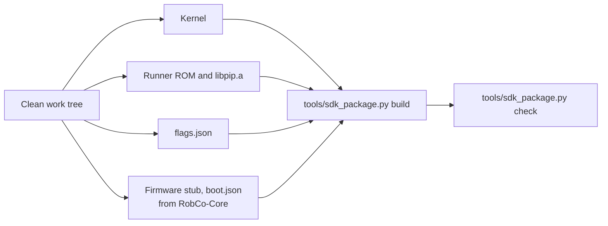

# The SDK package

`make sdk-package` writes `build/pipos-<version>.zip`, the `pipos` package that RobCo Studio installs. RobCo-Core's `docs/spec/SDK_PACKAGE.md` fixes its layout and its manifest, `sdk.json`. The version is the ABI of `sdk/include/pipos/abi.h` and `PACKAGE_BUILD`, so `1.4.0` today.

No package is published yet. A release needs the owner's agreement first.

## What the target does

1. It stops when a folder it reads holds an untracked file, in Pip-OS or in `external/robco-core`, and names the file. Then it stops when a tracked file has changes. `built_from` names the commits of Pip-OS and of `external/robco-core`, so both must hold every input. The headers in the package come from `git ls-files`, so an untracked header cannot get in. Each git call that feeds the package, the file list, the two `git status` checks and the commits of `built_from`, stops the build with git's own message when it fails or prints nothing. In a CI container git refuses a checkout another user owns, with "detected dubious ownership", unless the checkout and `external/robco-core` are both a `safe.directory` in the global git config. `tests/host/sdk_package_inputs_test.sh` checks each call with a fake `git`.
2. It builds again, in `build/sdk-package/`, the kernel, the runner ROM with its `libpip.a`, `flags.json`, RobCo-Core's firmware stub and `boot.json`, with RobCo-Core's own `make boot-json`.
3. Every compile gets `-ffile-prefix-map` for the repository, the build folder and the compiler's folder, the one that holds its `bin/`, which maps to `toolchain`. Without the last map the path of the compiler's own headers, `lib/gcc/arm-none-eabi/<version>/include`, lands in the debug info of `pipos.elf` and `libpip.a` when the compiler sits under the home folder, as on a GitHub runner. The make finds the folder from `$(CROSS)gcc -print-file-name=include` and maps it both as gcc prints it and as a plain path. A package built with the compiler at two paths is the same bytes. The maps go through `EXTRA_CFLAGS` for the kernel and `PATH_MAPS` of `pipos-app.mk` for the ROM and the library. The maps change the debug info only. The kernel image and the runner ROM are the same bytes as those of `make`.
4. `tools/sdk_package.py build` writes `sdk.json` and the archive. The firmware pins come from RobCo-Core's `tools/fetch_firmware.sh`. No firmware file goes in.
5. `tools/sdk_package.py check` checks the archive, then searches every file for the repository path, the build folder, `$HOME`, the user name and the host name.

## Same sources, same bytes

The archive holds `sdk.json` first, then the files in byte order of their names. Each entry is stored, not compressed, dated 1980-01-01 00:00, with mode 0644 and no extra field. `libpip.a` is archived with `ar rcsD`. Two runs from one commit with one compiler give the same SHA-256. Stored entries keep the bytes free of the zlib version.

## The compiler

`sdk.json` `tools` names the compiler that built `libpip.a`. `SDK_GCC_RELEASE`, `15.2.1-1.1` by default, is the xPack release it writes. The build stops unless `$(CROSS)gcc -dumpfullversion` prints the part before the first `-`, here `15.2.1`.

So a local build with another compiler fails until it names that compiler, such as `make sdk-package SDK_GCC_RELEASE=15.2.0`. That package is for tests only: no index lists a `gcc` of that version. The release package comes from the `sdk-package` workflow, which downloads xPack `15.2.1-1.1` for `linux-x64` and checks its SHA-256.

| Variable | Default | Meaning |
|---|---|---|
| `SDK_GCC_RELEASE` | `15.2.1-1.1` | The `gcc` version in `tools` |
| `SDK_QEMU_VERSION` | `10.1.2` | The `qemu` version in `tools`, the QEMU of the CI image |
| `PACKAGE_BUILD` | `0` | The third part of the version |
| `CROSS` | `arm-none-eabi-` | The compiler of the whole package |

## The checker

`python3 tools/sdk_package.py check <zip> --forbid <text>...` prints one `FAIL` line per broken rule and exits 1 when there is one. It checks:

- The file name: `<name>-<version>.zip`, with the name and the version of its `sdk.json`. A copy renamed to another version fails.
- Entry names: UTF-8 as raw bytes, relative, `/` only, no empty, `.` or `..` part, no drive letter, no two names equal or equal but for case by their lower or upper case forms.
- Each part of a name is a plain name on Linux, macOS and Windows: no `< > : " \ | ? *`, no control character, no ending dot or space, no Windows device name such as `CON` or `com1.txt`. The spec does not state this rule yet. RobCo Studio refuses such a package, so the check does too.
- No entry named `.robco-archive`, the file RobCo Studio adds to an installed package, and no file that is also the folder of another entry. RobCo Studio refuses both; the spec does not state them yet.
- Entries: regular files and folders only, stored or deflate.
- `sdk.json` at the root, at most 4 MiB as RobCo Studio reads it, with the fields a `pipos` package carries, each of its JSON type and form.
- `files`: sorted by path in byte order with no repeat, each path by the name rules above, each with its size and a lower case SHA-256 that match the entry. No entry unlisted and no listed path missing.
- The layout: every file of the spec's table and the ten headers, and nothing else but more headers in `include/pipos/`. No `include/pipos/pipos.h`.
- `licences` names no GPL licence. The check reads what `sdk.json` declares, not the licence of a file's bytes.
- No Pi firmware file.
- Every file entry can be read. An entry with an unknown method, a wrong CRC or encryption is a `FAIL` line with its name, and its bytes are neither hashed nor searched.
- No `--forbid` text in any file, `sdk.json` included.
- No `--user` name in the forms a tool writes it: `/home/NAME`, `/Users/NAME`, `\Users\NAME` and `NAME@`. The bare name is not searched. On a GitHub runner the user is `runner`, and `sdk.json` holds the format key `runner` and the path `boot/RUNNER.ROM`.

A hit names the file, the offset and the run of printable bytes around it, at most 80 on each side, so a log shows the whole path that got in. A text given twice, such as `$HOME` and the home folder of `--user`, is reported once.

A forbidden text under 4 characters is an error, not a pass: it would match by chance. The search compares bytes. It finds a Windows path only as written with single `\`, not with `/` or with the `\\` of a JSON string. The package is built on Linux only, so this is enough today.

What the check cannot decide from the archive alone: that each file comes from the source the spec names, that the headers equal `sdk/include/pipos/` byte for byte, that `tools` names the compiler that built `libpip.a`, and that `firmware` holds the pins of RobCo-Core's `tools/fetch_firmware.sh`. `make sdk-package` holds those when it builds.

`tests/tools/test_sdk_package.py` builds small packages in a temp folder and breaks each rule once. It needs no build. `make sdk-package-test` runs it.

## The workflow

`.github/workflows/sdk-package.yml` runs on every pull request, on `master` and on a tag `pipos-*`:

- `package` runs the checker's tests, downloads the xPack compiler, builds the package twice and compares the SHA-256, shows that the check refuses a copy with the host name planted in it, boots the package on the four boards in the CI image, and uploads the package as the `pipos-package` artifact. It holds `packages: read` to pull the CI image.
- `publish` runs only for a pushed tag `pipos-<version>`. It alone holds `contents: write`. It attaches the package of the `package` job to a release of that tag. The tag must name the package that was built: `pipos-1.4.0` builds with `PACKAGE_BUILD=0` and must give `pipos-1.4.0.zip`. The check has already compared that file name with `sdk.json`, so the tag, the file name and the version inside are one text.

## The boot check

The QEMU suite boots the kernel of the CI image's compiler. The package's kernel and firmware stub come from xPack 15.2.1. `make sdk-boot-test SDK_ZIP=<zip>` boots the package itself:

1. It unpacks `boot/PIPOS.IMG`, `boot/config.txt`, `boot/fwstub.bin`, `boot/RUNNER.ROM` and `boot.json`.
2. It builds the simulator card of RobCo-Core's `docs/spec/STUDIO_CLI.md` from them, with the test tape `run_exit0` as `PIPES.HTP`. It writes `PIPBOY/PIPOS.CFG` and `PIPBOY/RUNNER.CFG` as the spec has the tool write them, so the package's own `boot/PIPOS.CFG` is not on the card. It reads each file back from the card and compares it with its source.
3. It starts QEMU with the arguments `boot.json` gives each board, in its default mode.
4. It needs the runner's done line with `result=exit rc=0` and the key of its run line.

`BOARD` picks the boards, `all` by default. A board QEMU lacks, missing mtools or a `boot.json` without the four boards fails it. Nothing skips. The tape is built by the local compiler; only the package is under test. A local package needs `make sdk-package SDK_GCC_RELEASE=<your gcc version>` first.

## Not done yet

- The card is made with mtools, as in `tests/test_runner.py`, not with RobCo-Core's FatFs as the spec says. The kernel reads both.
- `licences` says MIT for every file, as the spec does. The kernel also holds FatFs, under its own BSD-style licence, and RobCo-Core's console font.
